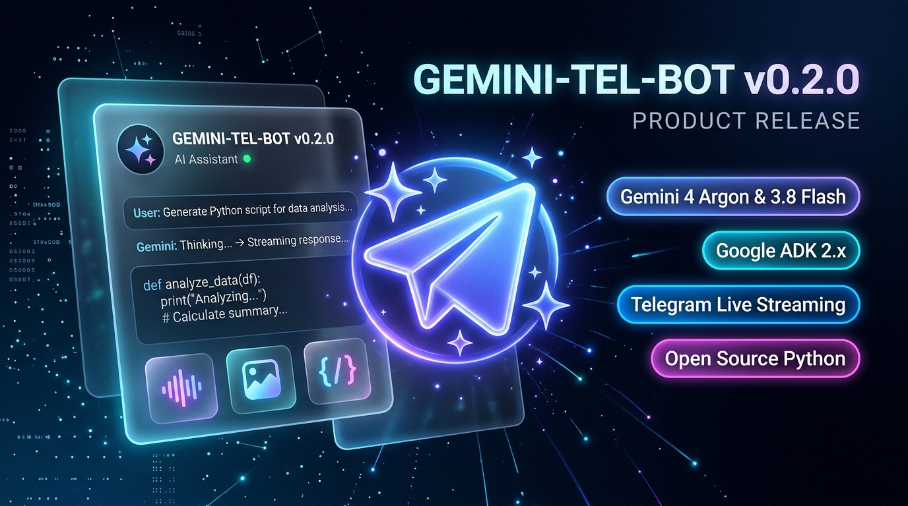

<p align="center">
  <a href="https://github.com/mohamadghaffari/gemini-tel-bot">
    
  </a>
</p>

<h1 align="center">
🤖 Gemini Telegram Bot
</h1>
<h2 align="center"> An Agentic Telegram Bot powered by Google Gemini & ADK 🚀 </h2>

[](https://github.com/mohamadghaffari/gemini-tel-bot/actions/workflows/mypy.yml)
[](https://github.com/mohamadghaffari/gemini-tel-bot/actions/workflows/lint-black.yml)

An advanced, **agentic Telegram bot** built with Python and the **Google Agent Development Kit (ADK)**. It leverages the latest **Google Gemini models** to provide a rich, interactive, and extensible chat experience. The bot supports multi-modal interactions (text, photos, URLs), advanced tool usage (including URL context retrieval, native Text-to-Speech, and image generation & photo editing with Gemini Image / Imagen), maintains conversation history, and offers flexible deployment options. Users can easily add new agents and tools to customize the bot for their specific use cases.

## ✨ Core Features & Capabilities

*   **🤖 Agentic AI Core (Google ADK 2.x):** Built with the Google Agent Development Kit (`google-adk`), enabling sophisticated tool use, function calling, SSE streaming, and an extensible agent-based architecture.
*   **🌐 Advanced Gemini Model Integration:** Interact with the latest Google Gemini models (`gemini-3.8-flash`, `gemini-3.7-flash`, `gemini-4-argon`, `gemini-3.1-pro-preview`, `gemma-4-31b-it`, and more). Automatically falls back from retired 1.x / 2.x models to `gemini-3.8-flash`.
*   **⚡ Real-Time Telegram Message Streaming (`sendMessageDraft`):** Streams partial responses live into Telegram using the Bot API's native `sendMessageDraft` endpoint and ADK's `StreamingMode.SSE`, complete with Telegram's native `"Thinking…"` indicator before the final formatted message is persisted.
*   **🛠️ Extensible Tool & Agent System:** Designed for easy addition of new custom tools and agents, allowing developers to tailor the bot's capabilities for diverse applications.
*   **📸 Multimodal Input:** Send text messages, photos with captions, and URLs to interact with the bot.
*   **💾 Conversation History:** Maintains context by remembering previous turns, including text, photo captions/placeholders, and outcomes of tool usage.
*   **🔑 User API Keys & ⚙️ Model Selection:** Users can manage their own Google Gemini API keys and select preferred models via commands.
*   **🚀 Flexible Deployment:** Supports both **Long Polling** mode (great for dedicated Ubuntu VPS servers or local development) and **Webhook** mode (via FastAPI/Uvicorn).
*   **💅 Rich Formatting (via [telegramify-markdown 1.4+](https://github.com/sudoskys/telegramify-markdown/)):**
    *   Entity-based formatting (`to_telebot_entities`) with `MarkdownV2` fallback.
    *   Sends large code blocks and tables as downloadable files.
    *   Renders Mermaid diagrams directly in chat.

### 🧰 Default Tools Showcase (Powered by ADK)
The bot comes with a set of pre-configured tools, demonstrating its agentic capabilities:
*   **🔗 URL Context Retrieval**: Provide URLs as context; the bot can fetch and use their content.
*   **🗣️ Native Text-to-Speech (TTS)**: Converts text responses into high-quality spoken audio.
*   **🖼️ Image Generation & Photo Editing (`gemini-3.1-flash-image` / Imagen)**: Generates brand-new images from text prompts and directly edits/transforms user-uploaded photos (e.g., background swaps, placing you in new scenes).
*   **🕒 Get Current Time**: Tells the current date and time.
*   **🌦️ Get Weather**: Provides current weather information for a specified city (requires `OPEN_WEATHER_API_KEY` configuration).
*   **📚 Chat History Access**: Can access and search within the current chat's history.
*   *(Easily add more tools based on your needs!)*

## 📝 Important Notes & Context


*   **💡 Project Evolution:** Originally a project exploring Gemini's capabilities, it has now evolved into an agentic application leveraging the Google Agent Development Kit (ADK) for enhanced functionality and extensibility.
*   **Multimodal Context:** The bot handles multimodal inputs. While direct re-interpretation of past images by the AI has limitations, context is maintained through text, captions, URL content, and tool outputs.
*   **Free Tier Considerations:** Deploying on free tiers (like Railway, Supabase) comes with limitations (usage, resources, cold starts) affecting performance. But you can enable a paid plan for handling more users if needed.

## 🛠️ Installation & Setup

### Installing from PyPI (Recommended for Users)

The `gemini-tel-bot` package is available on PyPI. You can install it using `pip` (or `uv pip`):

```bash
pip install gemini-tel-bot
```
Or with `uv`:
```bash
uv pip install gemini-tel-bot
```

**Important Setup for PyPI Users:**
After installation, you will need to:
1.  **Set up the Supabase Database:** Follow the instructions in the "2. Supabase Database Setup" section under "Development Setup" below. This is a one-time setup.
2.  **Configure Environment Variables:** Create a `.env` file as described in "4. Create `.env` File" (under "Development Setup"), or manage these environment variables according to your deployment method.

Once your database and environment are configured, you can run the bot using the script made available by the PyPI installation:
```bash
run-gemini-bot
```
This command is defined in your `pyproject.toml` and is installed into your Python environment's scripts directory by `pip` (or `uv pip`). For this command to be directly executable from your terminal, this scripts directory (e.g., `~/.local/bin` on Linux/macOS, or Python's `Scripts` folder on Windows) must be part of your system's `PATH` environment variable. This is a standard configuration for Python installations.

### Development Setup (for Contributors or Local Modification)

This setup is for those who want to contribute to the bot's development or run a modified version locally.

### 1. Prerequisites

*   Python 3.11+
*   Git
*   uv (see [uv installation guide](https://github.com/astral-sh/uv#installation))
*   A [Supabase](https://supabase.com/) account and project.
*   A [Telegram Bot Token](https://core.telegram.org/bots#6-botfather). You might want **two** tokens: one for production deployment and one specifically for local testing.
*   A [Google AI Studio / Google Cloud Project](https://aistudio.google.com/app/apikey) to get a Gemini API Key (can be used as the bot's default or provided by users).

### 2. Supabase Database Setup

This bot requires two tables in your Supabase project: `user_settings` and `chat_history`. You'll need to create these manually using the Supabase SQL Editor.

1.  Go to your [Supabase project dashboard](https://supabase.com/dashboard).
2.  In the left sidebar, navigate to the **SQL Editor**.
3.  Click on **"New query"** (or "+ New query").
4.  Copy the entire SQL block below and paste it into the query editor.
5.  Click **"RUN"**.

    ```sql
    -- Create user_settings table
    CREATE TABLE IF NOT EXISTS public.user_settings (
      chat_id BIGINT PRIMARY KEY,
      gemini_api_key TEXT NULL,
      selected_model TEXT NOT NULL DEFAULT 'gemini-3.8-flash',
      message_count INTEGER NOT NULL DEFAULT 0
    );

    COMMENT ON TABLE public.user_settings IS 'Stores user-specific settings like API keys and selected models.';
    COMMENT ON COLUMN public.user_settings.chat_id IS 'Telegram Chat ID (Primary Key)';
    COMMENT ON COLUMN public.user_settings.gemini_api_key IS 'User-provided Gemini API Key (nullable)';
    COMMENT ON COLUMN public.user_settings.selected_model IS 'Gemini model selected by the user';
    COMMENT ON COLUMN public.user_settings.message_count IS 'Message counter for users on the default API key';

    -- Create chat_history table
    CREATE TABLE IF NOT EXISTS public.chat_history (
      chat_id BIGINT NOT NULL,
      turn_index INTEGER NOT NULL,
      role TEXT NOT NULL,
      parts_json JSONB NULL, -- Can be NULL if a turn has no content (e.g., initial state)
      created_at TIMESTAMPTZ NOT NULL DEFAULT now(), -- Optional: Track creation time
      PRIMARY KEY (chat_id, turn_index) -- Composite primary key
    );

    COMMENT ON TABLE public.chat_history IS 'Stores the conversation history turns.';
    COMMENT ON COLUMN public.chat_history.chat_id IS 'Telegram Chat ID';
    COMMENT ON COLUMN public.chat_history.turn_index IS 'Sequential index of the turn within a chat';
    COMMENT ON COLUMN public.chat_history.role IS 'Role of the turn owner (user or model)';
    COMMENT ON COLUMN public.chat_history.parts_json IS 'JSONB array storing the parts (text, image placeholders) of the turn';

    -- Optional but Recommended: Create an index for faster history lookups
    CREATE INDEX IF NOT EXISTS idx_chat_history_chat_id_turn_index ON public.chat_history(chat_id, turn_index);
    ```
*   Your existing "Security Note" about the `service_role` key can remain directly after this SQL block.
*   **(Security Note):** The provided code typically uses the Supabase `service_role` key, which bypasses Row Level Security (RLS). If you need finer-grained control or plan to expose Supabase keys differently, configure RLS appropriately.

### 3. Create and Activate Virtual Environment (using uv)

Before cloning or installing dependencies, it's highly recommended to create a dedicated virtual environment for the project. If you have `uv` installed (see Prerequisites), you can do this easily:

```bash
# Navigate to where you want your project directory to be (or create it)
# mkdir gemini-tel-bot-project
# cd gemini-tel-bot-project

# Create a virtual environment (e.g., named .venv) using Python 3.11
uv venv -p python3.11 .venv

# Activate the virtual environment
# On macOS/Linux:
source .venv/bin/activate
# On Windows (PowerShell):
# .venv\Scripts\Activate.ps1
# On Windows (CMD):
# .venv\Scripts\activate.bat
```
Subsequent `uv` commands (like `uv sync`) will operate within this activated environment.

### 4. Clone & Install Dependencies for Development

1.  **Clone the Repository:**
    ```bash
    git clone https://github.com/mohamadghaffari/gemini-tel-bot
    cd gemini-tel-bot
    ```
    *(Note: If you are inside the project directory already, you can skip the clone and cd steps).*

2.  **Install Dependencies:** `uv` will create and manage a virtual environment for you.
    ```bash
    uv sync --locked --all-extras --dev # For development, includes dev tools
    ```
    `uv` automatically manages the project's virtual environment. To execute commands within this environment, you can use `uv run`. For example: `uv run run-gemini-bot`.

### 5. Create `.env` File

Create a file named `.env` in the project root by copying `.env.example` (e.g., `cp .env.example .env`).
**Do not commit the `.env` file to Git!** It should already be in your `.gitignore`.

Populate `.env` with your **local testing credentials**:
```dotenv
# .env - For Local Development / Testing
BOT_MODE=polling
BOT_API_KEY=<YOUR_LOCAL_TESTING_BOT_TOKEN>
SUPABASE_URL=<YOUR_SUPABASE_URL>
SUPABASE_KEY=<YOUR_SUPABASE_SERVICE_ROLE_KEY>
GOOGLE_API_KEY=<YOUR_GEMINI_API_KEY> # Optional: Bot's default operational Google API Key. If not set, users MUST provide their own.
# DEFAULT_MODEL_NAME=gemini-1.5-flash-latest # Optional: Overrides the in-code default model if set.
# MAX_HISTORY_LENGTH_TURNS=20 # Optional: Overrides the default history length (20 turns) if set.
# DEFAULT_KEY_MESSAGE_LIMIT=10 # Optional: Overrides the default message limit (10 messages) for the bot's GOOGLE_API_KEY if set. Set to 0 for no limit.
# LOADING_ANIMATION_FILE_ID=<YOUR_LOADING_ANIMATION_FILE_ID> # Optional: File ID for a GIF to show during processing. Send a GIF to the bot to get its ID.
# OPEN_WEATHER_API_KEY=<YOUR_OPENWEATHERMAP_API_KEY> # Optional: Required for the weather tool.
```
### 6. Run the Bot (Polling Mode for Development)

To run the bot in polling mode for local development, use the following command:
```bash
uv run run-gemini-bot
```
The bot will start polling Telegram for updates using your *local testing* bot token. You can interact with this test bot instance. Use `Ctrl+C` to stop.

### Ubuntu Server Deployment (systemd Service)

To run the bot as a 24/7 background service on an Ubuntu VPS server:

1. **Point your DNS record to your server IP (for Webhook Mode):**
   * Create an **A record** in your DNS provider (e.g., Cloudflare / Namecheap):
     * **Name / Host**: `bot` (for `bot.example.com`) or `@` (for `example.com`)
     * **Value / IPv4**: `<YOUR_SERVER_IP>`
2. **Copy the project (including your `.env`) to your Ubuntu server:**
   ```bash
   rsync -avz --exclude '.venv' --exclude '__pycache__' --exclude '.git' \
     ./ root@<YOUR_SERVER_IP>:/opt/gemini-tel-bot/
   ```
3. **SSH into the server and run the setup script:**
   ```bash
   ssh root@<YOUR_SERVER_IP>
   cd /opt/gemini-tel-bot
   chmod +x deploy/setup_ubuntu.sh

   # Option A: Webhook Mode with automatic HTTPS via Caddy (Recommended with domain)
   DOMAIN=bot.example.com ./deploy/setup_ubuntu.sh --webhook

   # Option B: Polling Mode (No domain/SSL required)
   ./deploy/setup_ubuntu.sh
   ```
4. **Manage the service:**
   ```bash
   # If running Webhook Mode:
   sudo systemctl status gemini-tel-bot-webhook
   sudo journalctl -u gemini-tel-bot-webhook -f
   sudo systemctl restart gemini-tel-bot-webhook

   # If running Polling Mode:
   sudo systemctl status gemini-tel-bot
   sudo journalctl -u gemini-tel-bot -f
   sudo systemctl restart gemini-tel-bot
   ```

### Production Deployment (Webhook Mode - e.g., Railway)

This uses an ASGI server (Uvicorn) with a FastAPI application to handle updates via a webhook.

1.  **Prerequisites:**
    *   A Git repository with your latest code pushed.
    *   A [Railway](https://railway.com?referralCode=6U8dFG) account (or similar PaaS supporting Python ASGI apps).
2.  **Code Structure:** Ensure your project includes:
    *   `pyproject.toml` (Defines dependencies and project metadata for uv. Railway will use this to install dependencies.)
    *   `Procfile` (e.g., `web: uvicorn gemini_tel_bot.api.webhook:app --host 0.0.0.0 --port $PORT --workers 1`)
    *   `src/gemini_tel_bot/cli.py` (Handles polling mode startup, invoked by `run-gemini-bot` script).
    *   `src/gemini_tel_bot/api/webhook.py` (FastAPI/ASGI application entry point).
    *   All other Python modules (`bot.py`, `handlers.py`, `config.py`, etc.).
3.  **Railway Project Setup:**
    *   Create a new Railway project linked to your Git repository.
    *   Railway should detect the `Procfile` and, given the `pyproject.toml` file, will use uv to build your environment.
4.  **Configure Environment Variables on Railway:**
    *   In Railway's "Variables" tab, set the following (use your **production** credentials):
        *   `BOT_MODE`: `webhook` (Ensure this is set)
        *   `BOT_API_KEY`: `<YOUR_PRODUCTION_BOT_TOKEN>`
        *   `SUPABASE_URL`: `<YOUR_SUPABASE_URL>`
        *   `SUPABASE_KEY`: `<YOUR_SUPABASE_SERVICE_ROLE_KEY>`
        *   `GOOGLE_API_KEY`: `<YOUR_GEMINI_API_KEY>` (Optional: The bot's default operational Google API Key. If not set, users must provide their own via /set_api_key for the bot to function with Gemini.)
        *   `DEFAULT_MODEL_NAME`: (Optional: Overrides the in-code default model, e.g., `gemini-1.5-flash-latest`)
        *   `MAX_HISTORY_LENGTH_TURNS`: (Optional: Overrides the default history length of 20 turns if set.)
        *   `DEFAULT_KEY_MESSAGE_LIMIT`: (Optional: Overrides the default message limit of 10 for the bot's `GOOGLE_API_KEY`. Set to `0` for no limit. Applies if `GOOGLE_API_KEY` is used.)
        *   `PYTHON_VERSION`: `3.11` (Or your target Python version, good practice for Railway)
5.  **Deploy:** Railway will build and deploy based on your Git pushes. Monitor build/deploy logs.
6.  **Set Telegram Webhook:**
    *   Get your Railway service's public URL (e.g., `https://your-app-name.up.railway.app`).
    *   Construct the full webhook URL: `https://your-app-name.up.railway.app/api/webhook` (This path is defined in your `src/gemini_tel_bot/api/webhook.py` FastAPI application).
    *   Set the webhook via browser or `curl`:
        ```
        https://api.telegram.org/bot<YOUR_PRODUCTION_BOT_TOKEN>/setWebhook?url=<YOUR_FULL_WEBHOOK_URL>
        ```
        Verify the success response from Telegram.

## 🎮 Usage

Start a chat with your bot on Telegram (either the local test instance or the deployed production one).

*   Send text messages or photos with captions to chat with the AI.
*   Look out for formatted responses, code sent as files, and rendered Mermaid diagrams!
*   Use commands:
    *   `/start` or `/help`: Show welcome message and commands list.
    *   `/reset`: Clear your chat history.
    *   `/set_api_key`: Start setting your personal Gemini API key.
    *   `/clear_api_key`: Revert to the bot's default key.
    *   `/list_models`: List models available with your current API key.
    *   `/select_model`: Choose a model via buttons.
    *   `/current_settings`: Show your current configuration.

## 🐛 Debugging

*   **Local (Polling):** Check the console output where you ran `uv run run-gemini-bot`. Increase log levels if needed (see [`src/gemini_tel_bot/cli.py`](src/gemini_tel_bot/cli.py)).
*   **Production (Webhook):**
    *   **Railway Logs:** Your primary debugging tool.
    *   **Telegram Webhook Info:** Use `https://api.telegram.org/bot<TOKEN>/getWebhookInfo` to check for errors reported by Telegram (`last_error_message`, `last_error_date`) and the pending update count. Ensure the URL matches exactly what you set.
    *   **Database:** Verify Supabase credentials and table structure.
    *   **AI API:** Check API keys and model validity.

## Configuration

### Optional Environment Variables

-   `OPEN_WEATHER_API_KEY`: Your API key from [OpenWeatherMap](https://openweathermap.org/appid). Required if you want to enable the weather information tool. Add this to your `.env` file.

### Extensibility

The agentic architecture powered by Google ADK makes it straightforward to:
-   Define new tools with specific functionalities.
-   Create specialized agents that utilize these tools for complex tasks.
-   Integrate with various APIs and services.

---

## 📜 License

This project is licensed under the MIT License - see the [LICENSE](https://raw.githubusercontent.com/mohamadghaffari/gemini-tel-bot/main/LICENSE) file for details.
